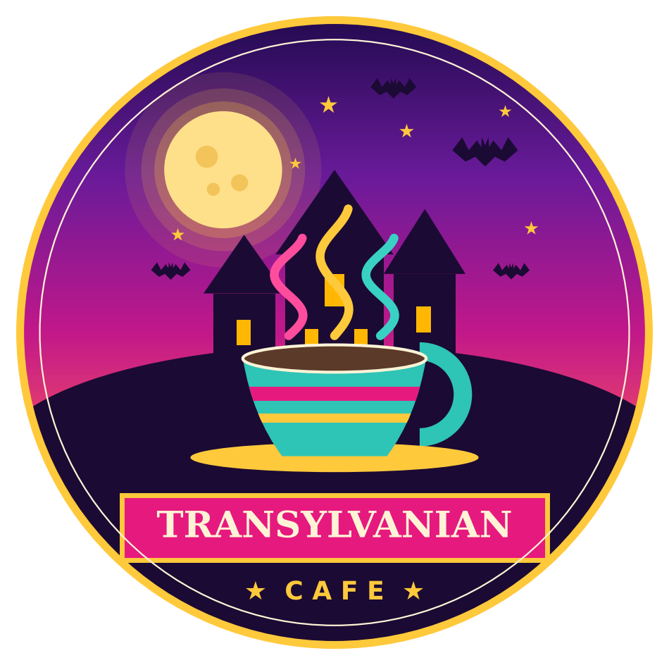

### Step 1 - Logo

```{r}

```


### Step 2 - Finding a location

address = "1819 S Kihei Rd, Kihei, HI 96753 (Kukui Mall)"

lat = 20.735034

lon = -156.452331

### Step 3 - Map the competition

```{r}
library(osmdata)

kihei_bb <- c(xmin = -156.50, ymin = 20.66, xmax = -156.40, ymax = 20.80)

cafe_query <- opq(bbox = kihei_bb, timeout = 180) |> add_osm_features(features = list("amenity" = "cafe", "shop" = "coffee"))

osm_raw <- osmdata_sf(cafe_query)

cafe_points <- as.data.frame(osm_raw$osm_points)
```

```{r}
library(sf)
library(dplyr)
library(leaflet)

shop_ll <- st_as_sf(data.frame(lon = -156.452331, lat = 20.735034),
                    coords = c("lon", "lat"), crs = 4326)

# Keep named cafe points only so that unnamed buildings are dropped
cafes <- osm_raw$osm_points |> filter(!is.na(name))

# Cafes within 1 km of the shop
dist_m <- as.numeric(st_distance(cafes, shop_ll))
sum(dist_m <= 1000)

leaflet() |>
  addProviderTiles(providers$CartoDB.Positron) |>
  addCircles(lng = -156.452331, lat = 20.735034, radius = 1000,
             color = "#E6197F", fill = FALSE) |>
  addCircleMarkers(data = cafes, radius = 5, color = "#2EC4B6", popup = ~name) |>
  addMarkers(lng = -156.452331, lat = 20.735034, popup = "Transylvanian Cafe")
```

### Step 4.1 - Resident Customer Demographics

```{r}
library(tidycensus)
library(tidyverse)
library(sf)


maui_tracts <- get_acs(
  geography = "tract", state = "HI", county = "Maui",
  variables = c(total_pop     = "B01001_001",
                med_hh_income = "B19013_001",
                med_gross_rent = "B25064_001",
                commuters     = "B08301_001",
                wfh           = "B08301_021"),
  year = 2023, survey = "acs5", geometry = TRUE, output = "wide"
) |>
  mutate(pct_wfh = wfhE / commutersE * 100)


# Find the tract containing the shop
shop_pt <- st_as_sf(data.frame(lon = -156.452331, lat = 20.735034),
                    coords = c("lon", "lat"), crs = 4326) |>
  st_transform(st_crs(maui_tracts))

shop_tract <- maui_tracts[st_nearest_feature(shop_pt, maui_tracts), ]

# Maps median household income with an outline of the shop tract
ggplot(maui_tracts) +
  geom_sf(aes(fill = med_hh_incomeE), color = "white") +
  geom_sf(data = shop_tract, fill = NA, color = "#E6197F", linewidth = 1.2) +
  geom_sf(data = shop_pt, size = 3) +
  coord_sf(xlim = c(-156.55, -156.35), ylim = c(20.60, 20.90)) +
  scale_fill_viridis_c(labels = scales::dollar, na.value = "grey90") +
  labs(title = "Median household income", fill = "Income") +
  theme_void()
```

```{r}
shop_tract |>
  st_drop_geometry() |>
  select(Tract = NAME,
         `Total population` = total_popE,
         `Median household income` = med_hh_incomeE,
         `Median gross rent` = med_gross_rentE,
         `Total commuters` = commutersE,
         `Work from home` = wfhE,
         `% work from home` = pct_wfh) |>
  pivot_longer(-Tract, names_to = "Measure", values_to = "Value") |>
  knitr::kable(digits = 1)
```

### Step 4.2 - Working Customer Demographics

```{r}
library(lehdr)
library(tidyverse)
library(sf)

wac <- grab_lodes(state = "hi", year = 2022, lodes_type = "wac",
                  job_type = "JT00", segment = "S000", agg_geo = "tract")

jobs_sf <- maui_tracts |>
  select(GEOID) |>
  left_join(wac |> rename(GEOID = starts_with("w_")), by = "GEOID") |>
  mutate(C000 = replace_na(C000, 0),
         pct_high_earn = CE03 / C000 * 100) 
# C000 is the total number of jobs located in the tract
# CE03 is the number of jobs that pay more than $3,333 per month (the highest of LODES’s three earnings brackets)

ggplot(jobs_sf) +
  geom_sf(aes(fill = C000), color = "white", linewidth = 0.2) +
  geom_sf(data = shop_tract, fill = NA, color = "#E6197F", linewidth = 1.2) +
  geom_sf(data = shop_pt, size = 3) +
  coord_sf(xlim = c(-156.55, -156.35), ylim = c(20.60, 20.90)) +
  scale_fill_viridis_c(option = "magma", direction = -1) +
  labs(title = "Total jobs by tract", fill = "Jobs") +
  theme_void()

ggplot(jobs_sf) +
  geom_sf(aes(fill = pct_high_earn), color = "white", linewidth = 0.2) +
  geom_sf(data = shop_tract, fill = NA, color = "#E6197F", linewidth = 1.2) +
  geom_sf(data = shop_pt, size = 3) +
  coord_sf(xlim = c(-156.55, -156.35), ylim = c(20.60, 20.90)) +
  scale_fill_viridis_c(option = "magma", direction = -1, na.value = "grey90") +
  labs(title = "Share of jobs paying > $3,333/month", fill = "% of jobs") +
  theme_void()
```

### Step 5 - What's nearby?

```{r}
library(mapboxapi)
library(sf)
library(leaflet)

my_token <- Sys.getenv("MAPBOX_PUBLIC_TOKEN")

shop_ll <- st_as_sf(data.frame(lon = -156.452331, lat = 20.735034),
                    coords = c("lon", "lat"), crs = 4326)

# 5-minute drive during morning rush hour
drive_5 <- mb_isochrone(shop_ll, time = 5, profile = "driving-traffic",
                        depart_at = "2026-11-23T07:30", access_token = my_token)

# 10-minute walk
walk_10 <- mb_isochrone(shop_ll, time = 10, profile = "walking", access_token = my_token)

leaflet() |>
  addProviderTiles(providers$CartoDB.Positron) |>
  addPolygons(data = drive_5, color = "#E6197F", fillOpacity = 0.25) |>
  addPolygons(data = walk_10, color = "#2EC4B6", fillOpacity = 0.4) |>
  addMarkers(lng = -156.452331, lat = 20.735034, popup = "Transylvanian Cafe") |>
  addLegend(colors = c("#E6197F", "#2EC4B6"),
            labels = c("5-min drive (Mon 7:30 AM)", "10-min walk"))
```

### Step 6 - Do you need a generator?

```{r}
library(tidyverse)
library(here)

outages <- read_csv(here("data/eaglei_outages_2025.csv"))

# Maui County FIPS
maui <- filter(outages, fips_code == 15009)

ggplot(maui, aes(run_start_time, customers_out)) +
  geom_line() +
  labs(title = "Power outages in Maui County, 2025", x = "Date", y = "People without power")
```

### Step 7 - Conclusion

Kukui Mall at 1819 S Kihei Rd and it is a location I found that would fit Transylvanian Cafe very well. I believe the fact it is in a little mall in Maui gives it potential to be a major tourist attraction, as it is still somewhere where many tourists will visit, while not being on an island so big it might get lost within all the other hundreds of thousands of Cafes. The listing shows units from 192 to 1,200 square feet at roughly \$4 to \$10 per square foot per month, meaning it is not super expensive for a starting shop. The mall has the only cinema in the Kihei, Wailea, and Makena markets, meaning it will always have people coming to visit to watch movies of all kinds, specifically in the evenings, where customers may be interested in the more gothic style cafe, specifically after potentially scary movies! Our OSM map found 3 cafes within 1 km of the site, so competition is not extremely high for an outdoor mall, but not very small either. I think the colorful gothic theme and will make people more interested in our cafe. Census data shows the shop’s tract has about 2695 residents, a median household income of a little above \$100k and a little over 20% of workers working from home, which means there will be a good amount of people looking to work in a nice cafe and have the money to buy from that specific cafe. LODES workforce data shows an okay amount of jobs located in the tract, about 45% of them higher-paying. The mall is very driveable, and the map shows a 5-minute drive at morning rush hour covers a pretty large distance, meaning commuters can grab a coffee on the way to work. Maui County had very constant power outage events in 2025 with a peak of over 22,000 customers affected, so I would budget for a generator to protect refrigeration and espresso equipment. While the area does not have a super large amount of jobs, and they are not extremely highly paying either, the location being near a movie theater, matching night time and movie vibes, and in a mall with a reasonable prices means I believe it is a pretty good place for a cafe to be located!
